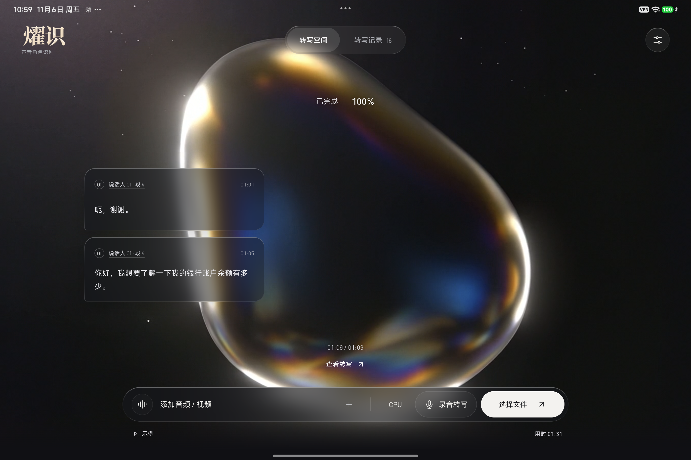
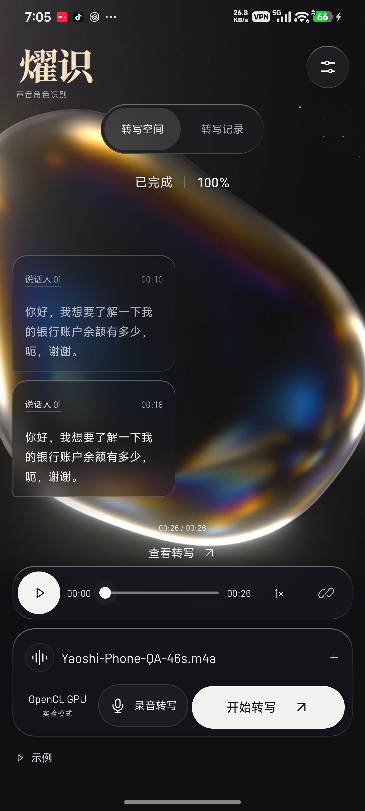
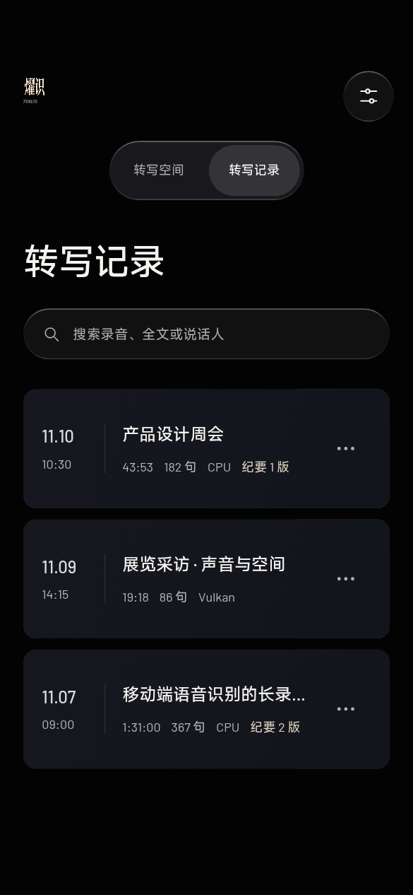
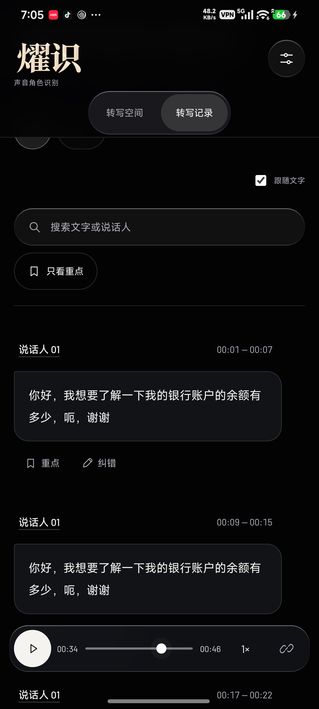
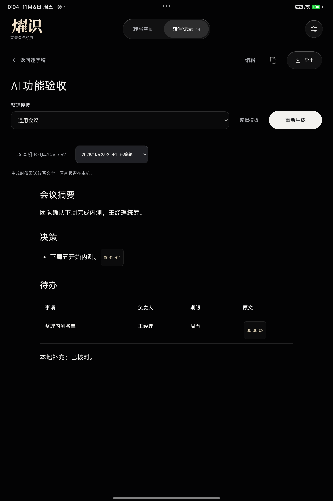

<h1 align="center">燿识 · Yaoshi</h1>

在 Android 上把录音整理成可回听、可校对的文字与会议纪要。

  

## 第一次转写

1. 在 Android 15 或更高版本的 64 位 ARM 手机或平板（ARMv8.2-A，支持 FP16 和点积指令）上安装 APK。[下载最新版](https://github.com/wdmhydw/yaoshi-android/releases/latest)
2. 打开首页的 **获取模型 → 下载并启用模型**。约 941 MiB 的 Q8_0 文件来自推理引擎维护者的 Hugging Face 仓库。可以暂停、离开页面、稍后续传。SHA-256 校验通过后即可使用。[模型文件](https://huggingface.co/mudler/moss-transcribe.cpp-gguf/blob/54e4bbd17da3f84adf1c1bcf7791b9b9266f741e/moss-transcribe-q8_0.gguf)
3. 点 **示例** 试转写随包的中文录音，再选择自己的音频、视频或麦克风。在 **转写记录** 里搜索、回听或导出。已经有配套 GGUF 的设备，也可在设置中选择 **从文件导入**。

## 从录音到纪要

- **转写和回听**　语音识别、说话人匹配和历史检索在设备上运行。逐句时间轴支持回听、标注和校对。
- **整理和导出**　可选 AI 纪要使用你配置的供应商，只在主动生成时发送转写文字和整理上下文。纪要内可以跳回原音，导出的 Markdown 和 Word 保留正文并清理回听标记。
- **设备兼容**　默认 CPU，支持的设备可选择 Vulkan 或 OpenCL。首次试用可用同一段音频比较速度和文字，两个 GPU 后端的表现取决于驱动。同一份 APK 用于手机和平板。

   

展示图来自设备验收。记录卡片使用测试标题，纪要使用模拟会议，转写示例来自 PolyAI MInDS-14。点图可查看原始尺寸。

## 工程与研究

- [从源码构建及运行测试](docs/build.md)
- [玄戒 O3 NPU 实验记录与可复现探针](docs/research/xring-o3.md)
- [本版验收与签名](docs/ACCEPTANCE_LOG.md) · [反馈问题](https://github.com/wdmhydw/yaoshi-android/issues)

燿识的 Android 应用代码采用 Apache-2.0。语音模型来自 OpenMOSS，移动端推理基于 LocalAI 维护的 moss-transcribe.cpp 和 ggml。首页视频、字体、测试录音和其他第三方材料的授权分别见项目声明。[许可证](LICENSE) · [组件与素材出处](android/THIRD_PARTY_NOTICES.txt) · [原始语音模型](https://huggingface.co/OpenMOSS-Team/MOSS-Transcribe-Diarize) · [推理引擎](https://github.com/localai-org/moss-transcribe.cpp)
